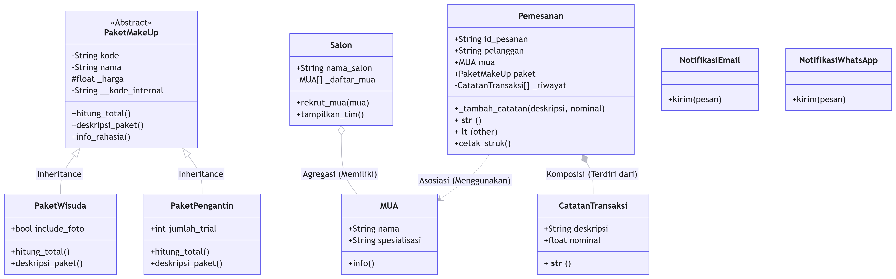
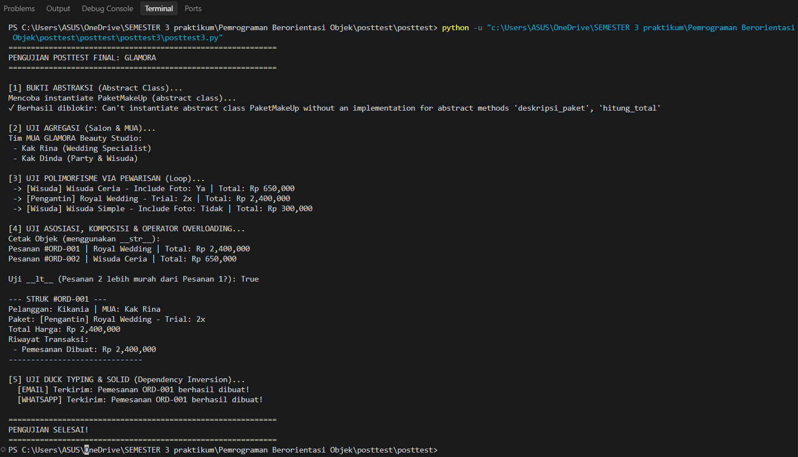

# Posttest PBO Lanjutan: GLAMORA

**Nama**: Kikania Agarista  
**NIM**: 2509106086  
**Tema**: GLAMORA - Sistem Manajemen Pemesanan Jasa Make Up  

---

## 1. Deskripsi Program
Program ini adalah sistem manajemen untuk **GLAMORA Beauty Studio** yang mengelola data Make Up Artist (MUA), paket make up, dan transaksi pemesanan. Program ini mengimplementasikan konsep Object-Oriented Programming (OOP) lanjutan sesuai materi Modul 4 hingga Modul 7, meliputi UML Class Relationships, Abstraksi (ABC), Polimorfisme, dan prinsip SOLID.

---

## 2. Class Diagram & Relasi UML

*(Diagram di atas dibuat menggunakan tools UML dan merepresentasikan relasi antar kelas dalam sistem GLAMORA)*

### Penjelasan Relasi UML:
1. **Agregasi (`Salon` o-- `MUA`)**: Kelas `Salon` "memiliki" daftar objek `MUA`. Relasi ini dipilih karena objek `MUA` dibuat di luar kelas `Salon` dan hanya didaftarkan ke dalamnya. Alasan memilih agregasi adalah karena siklus hidup `MUA` mandiri; jika objek `Salon` dihapus, objek `MUA` tetap ada dan bisa bekerja di tempat lain.
2. **Komposisi (`Pemesanan` *-- `CatatanTransaksi`)**: Kelas `Pemesanan` "terdiri dari" objek `CatatanTransaksi`. Relasi ini dipilih karena objek `CatatanTransaksi` dibuat secara eksklusif di dalam method `_tambah_catatan()` milik `Pemesanan`. Berbeda dengan agregasi, siklus hidupnya terikat penuh; jika objek `Pemesanan` dihapus, riwayat catatannya ikut musnah.
3. **Asosiasi (`Pemesanan` ..> `MUA` & `Pelanggan`)**: Kelas `Pemesanan` "menggunakan" data `MUA` dan `Pelanggan`. Relasi ini dipilih karena objek-objek tersebut hanya dilewatkan sebagai parameter saat pemesanan dibuat, tanpa ada kepemilikan permanen atau kontrol siklus hidup oleh kelas `Pemesanan`.

---

## 3. Penerapan Abstraksi & Inheritance
- **Abstract Class**: `PaketMakeUp` didefinisikan menggunakan modul `abc` sebagai kontrak induk.
- **Abstract Method**: Memiliki 2 method abstrak (`@abstractmethod`), yaitu `hitung_total()` dan `deskripsi_paket()`, yang memaksa subclass untuk mengimplementasikannya.
- **Concrete Method**: Memiliki 1 method konkret `info_rahasia()` yang diwariskan dan bisa dipakai langsung oleh semua subclass.
- **Inheritance**: `PaketWisuda` dan `PaketPengantin` mewarisi `PaketMakeUp` menggunakan `super().__init__()` dan menambahkan atribut unik masing-masing (`include_foto` dan `jumlah_trial`).
- **Bukti Abstraksi**: Program menggunakan blok `try-except TypeError` di bagian main code untuk membuktikan bahwa mencoba membuat objek langsung dari `PaketMakeUp` akan ditolak oleh Python.

---

## 4. Penerapan Polimorfisme
1. **Via Pewarisan (Inheritance Polymorphism)**: Method `hitung_total()` dan `deskripsi_paket()` di-override oleh kedua subclass dengan logika perhitungan yang berbeda. Dibuktikan melalui perulangan `for` yang memproses daftar objek subclass secara dinamis tanpa mengecek tipe objeknya.
2. **Duck Typing**: Kelas `NotifikasiEmail` dan `NotifikasiWhatsApp` tidak memiliki hubungan pewarisan, tetapi keduanya memiliki method `kirim()`. Fungsi `proses_notifikasi()` menerima keduanya tanpa perlu mengecek tipe objeknya (menghindari anti-pattern `if type()`).
3. **Operator Overloading**: Kelas `Pemesanan` mengimplementasikan magic method `__str__` (agar bisa di-print langsung dengan format rapi) dan `__lt__` (untuk membandingkan total harga antar pesanan menggunakan operator `<`).

---

## 5. Nilai Plus: Prinsip SOLID
Program ini menerapkan 2 prinsip SOLID secara wajar:
1. **Dependency Inversion Principle (DIP)**: Fungsi `proses_notifikasi()` bergantung pada **abstraksi** (objek apa pun yang memiliki method `kirim()`), bukan pada implementasi konkret. Ini memungkinkan penambahan kanal notifikasi baru (misal: `NotifikasiSMS`) tanpa mengubah satu baris pun kode di dalam fungsi tersebut.
2. **Open/Closed Principle (OCP)**: Jika ingin menambah jenis paket baru (misal: `PaketParty`), cukup buat subclass baru yang mewarisi `PaketMakeUp` tanpa perlu mengubah kode yang sudah ada di kelas induk atau loop pemrosesan.

---

## 6. Output Program

*(Screenshot di atas menunjukkan hasil eksekusi program, termasuk bukti `TypeError` saat mencoba menginstansiasi abstract class `PaketMakeUp`, serta hasil dari polimorfisme dan duck typing)*

---

**Dibuat untuk memenuhi tugas praktikum Pemrograman Berorientasi Objek.**
